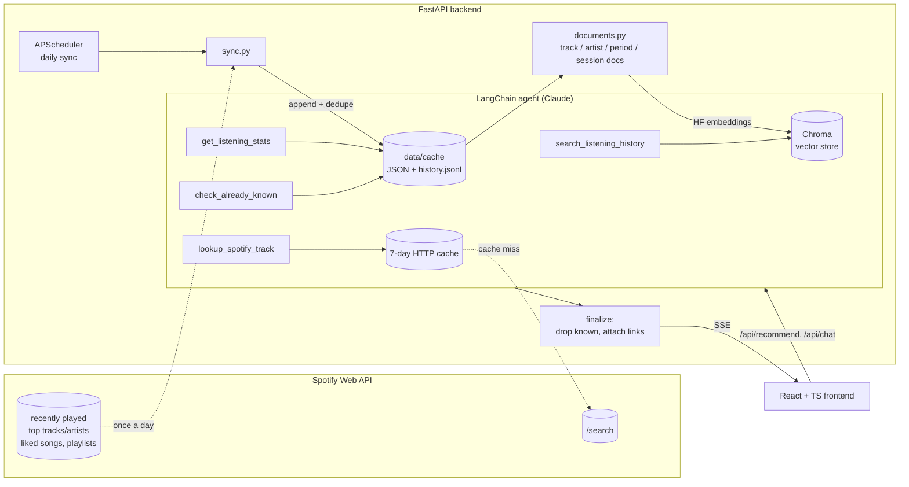

# Spotify RAG Personal Recommender

[](https://github.com/siddnarayanan/spotify-rag-personal-recs/actions/workflows/ci.yml)

A personal music recommendation **agent** that grounds its suggestions in *your* Spotify listening history using **Retrieval-Augmented Generation**. It is built with **LangChain** and **Claude**, a **FastAPI** backend, and a **React + TypeScript** frontend.

The agent retrieves what you've actually been playing from a local vector store. It reasons about your taste, proposes new tracks, filters out songs you already know, checks each pick against the Spotify catalog, and explains every recommendation with evidence from your history.

## Demo


## Highlights

- **RAG over personal data.** Listening history is turned into semantically rich documents (tracks, artists, time-range "taste" summaries, daily sessions, playlists). They are embedded locally with Hugging Face `sentence-transformers` and stored in a persistent **Chroma** index.
- **Tool-calling agent.** A LangChain `create_agent` agent (Claude) decides what to retrieve and when. It has four tools: semantic history search, aggregate stats, an "already known?" check, and a cached Spotify catalog lookup. Its output is **structured** (Pydantic) through LangChain's `ProviderStrategy`, which uses Claude's native JSON-schema output.
- **Built around Spotify's rate limits.** Spotify is hit at most **once a day** by a scheduled sync. Catalog lookups go through a 7-day on-disk HTTP cache, and `429 Retry-After` is honoured with backoff.
- **Guardrails in code, not only in prompts.** A deterministic post-processing step removes tracks already in your library and duplicates, then attaches real Spotify links and album art.
- **Streaming UX.** Agent tool steps and recommendation cards stream to the UI over Server-Sent Events. A multi-turn chat streams tokens live.
- **Runs without credentials.** A fictional sample dataset and `DEMO_MODE` let anyone try the app.
- **Tested and CI'd.** An offline pytest suite (mocked Spotify, fake embeddings, fake agent) runs on GitHub Actions, along with ruff and a frontend type-check, lint and build.

## Architecture



### How a recommendation is made

1. **Ground.** The agent calls `get_listening_stats` and several `search_listening_history` queries, for example recent sessions, top artists, or the mood you typed. Retrieval uses **MMR** (maximal marginal relevance), so the context is relevant without being repetitive. It can also filter by document type.
2. **Generate.** Claude brainstorms candidates from its music knowledge, conditioned on the retrieved history.
3. **Filter.** `check_already_known` drops tracks you already have and flags artists that are new to you.
4. **Verify.** `lookup_spotify_track` confirms that each pick exists in the catalog. Results are cached, so repeated checks are free.
5. **Enforce.** The server re-checks the structured output deterministically and streams the final cards. Each card includes a `reason` and the `evidence` from your history that inspired it.

### Why the agent generates candidates (Spotify API constraints)

In November 2024 Spotify removed `/recommendations`, `/related-artists`, `/audio-features` and 30-second previews for new apps. So this project doesn't ask Spotify what to recommend. It uses **RAG for personalisation** and the **LLM for discovery**, then **Spotify Search for verification**.

Spotify also returns only your **last 50 plays**. The daily sync therefore **appends and de-duplicates** into `history.jsonl`, so the retrieval corpus gets richer every day the app runs.

### Caching and rate limits

| Concern | Approach |
|---|---|
| Listening data | Synced at most once per `SYNC_INTERVAL_HOURS` (default 24). An hourly scheduler check plus a staleness check on startup means restarts never cause extra syncs. |
| Manual sync | `POST /api/sync` has a 60-minute cooldown. |
| Catalog lookups | Cached on disk with `requests-cache` (SQLite) for 7 days. |
| 429s | spotipy/urllib3 retry with backoff that honours `Retry-After`. |
| Re-indexing | The Chroma index is rebuilt only when the document content hash changes. |
| Writes | Atomic temp-file + rename, so a crash can't corrupt the cache. |

## Tech stack

| Layer | Tools |
|---|---|
| LLM / agent | LangChain 1.x (`create_agent`, `ProviderStrategy` structured output), LangGraph checkpointer for chat memory, Claude via `langchain-anthropic` |
| Retrieval | Chroma (`langchain-chroma`), `sentence-transformers/all-MiniLM-L6-v2` (`langchain-huggingface`), MMR search |
| Backend | Python 3.12, FastAPI, sse-starlette, APScheduler, spotipy, requests-cache, pydantic-settings, uv |
| Frontend | React 19, TypeScript, Vite |
| Quality | pytest, ruff, oxlint, GitHub Actions |

## Getting started

**Prerequisites:** [uv](https://docs.astral.sh/uv/), Node 20+, and Anthropic credentials. Use either:

- an [API key](https://console.anthropic.com) in `ANTHROPIC_API_KEY`, or
- the Anthropic CLI: `brew install ant && ant auth login`. Leave `ANTHROPIC_API_KEY` blank and the SDK picks up the profile and refreshes its token automatically. (`ChatAnthropic` always sends an `api_key`, which skips the SDK's credential chain, so the backend uses a small subclass to fix that.)

```bash
git clone https://github.com/siddnarayanan/spotify-rag-personal-recs.git
cd spotify-rag-personal-recs
cp .env.example backend/.env       # then fill in the values

cd backend && uv sync && cd ..
cd frontend && npm install && cd ..
```

### Option A: demo mode (no Spotify account needed)

Set `DEMO_MODE=true` in `backend/.env`. You still need Anthropic credentials (see above). Then run:

```bash
# terminal 1
cd backend && uv run fastapi dev app/main.py --host 127.0.0.1
# terminal 2
cd frontend && npm run dev
```

Open http://127.0.0.1:5173. The app uses the **fictional** listener in [`data/sample/`](data/sample/README.md).

### Option B: your own Spotify data

1. Create an app at the [Spotify Developer Dashboard](https://developer.spotify.com/dashboard).
2. Add the redirect URI **`http://127.0.0.1:8000/auth/callback`**. Spotify requires a loopback IP; `localhost` won't work.
3. Put `SPOTIFY_CLIENT_ID` and `SPOTIFY_CLIENT_SECRET` in `backend/.env` and set `DEMO_MODE=false`.
4. Start both servers as above, open http://127.0.0.1:5173 and click **Connect Spotify**. The first sync and indexing run in the background.

Your data is written to `data/cache/` and indexed into `data/chroma/`. Both are **gitignored**.

To force a sync from the CLI, run `cd backend && uv run python -m scripts.sync_now`.

## API

| Method | Path | Description |
|---|---|---|
| `GET` | `/api/status` | Mode, auth/LLM configuration, last and next sync, counts |
| `GET` | `/api/history` | Recent plays and short-term top artists/tracks |
| `POST` | `/api/recommend` | SSE stream: `status` (tool steps) → `summary` → `recommendation`… → `done` |
| `POST` | `/api/chat` | SSE stream: `token`, `status`, `done`. Multi-turn via `thread_id` |
| `POST` | `/api/sync` | Force a Spotify sync and reindex (60-minute cooldown) |
| `POST` | `/api/reindex` | Rebuild the vector index |
| `GET` | `/auth/login`, `/auth/callback` | Spotify OAuth |

Interactive docs are at http://127.0.0.1:8000/docs.

## Project structure

```
backend/
  app/
    spotify/   auth.py · client.py (rate limits, cached search) · sync.py (daily snapshot)
    rag/       documents.py (cache → Documents) · index.py (Chroma) · retriever.py (MMR)
    agent/     tools.py · prompts.py · agent.py (create_agent + finalize) · library.py
    routes/    api.py (JSON + SSE) · auth.py
    scheduler.py · store.py · schemas.py · config.py · main.py
  scripts/     sync_now.py · build_sample.py
  tests/       offline pytest suite
frontend/src/
  api/client.ts           typed client + POST-SSE parser
  components/             RecommendPanel, RecommendationCard, ChatPanel, ListeningDashboard, …
data/
  sample/                 fictional demo dataset (committed)
  cache/, chroma/         your data (gitignored)
```

## Development

```bash
cd backend && uv run pytest && uv run ruff check .
cd frontend && npm run lint && npm run build
```

## Possible extensions

- An evaluation harness: an LLM-as-judge or a hold-out test where recent plays are hidden and recall is measured
- A hybrid retriever (BM25 + vectors) and re-ranking
- A feedback loop, where thumbs up/down on cards becomes new documents
- Deployment with a managed vector DB and per-user auth

## License

[MIT](LICENSE)
